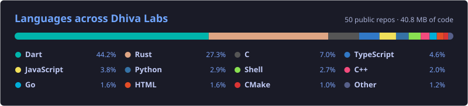

<!-- ===== HEADER ===== -->


<div align="center">
  <a href="https://www.dhivalabs.com/">
    
  </a>

  <p>
    <a href="https://www.dhivalabs.com/"></a>
    <a href="https://snapcraft.io/publisher/dhivakar1010"></a>
    <a href="https://launchpad.net/~dhiva-labs/+archive/ubuntu/apps"></a>
    <a href="https://www.linkedin.com/company/dhiva-labs"></a>
    <a href="mailto:reachout@dhivalabs.com"></a>
    <a href="https://github.com/sponsors/Dhiva-Labs"></a>
  </p>
</div>

<!-- ===== ABOUT ===== -->
## 👋 Welcome

**Dhiva Labs** is an independent software lab in Chennai, India, founded by [Dhivakar Rajaram](https://github.com/dhivadhiva). We build finished apps for Linux, Windows and Android: developer tools, desktop utilities, mobile apps, Monero tooling and offline AI. Every app here is open source and ships as a real release, through the Snap Store, a Launchpad PPA, the Microsoft Store and GitHub Releases.

<div align="center">

`Simple` · `Fast` · `Private` · `Cross-platform` · `Open source`

</div>

<!-- ===== NUMBERS ===== -->
## 📊 The Lab in Numbers

<div align="center">
  
  
  
  
  <br/>
  
  
  
  
  
</div>

<br/>

<div align="center">
  
  <br/>
  <sub>Refreshed daily by GitHub Actions</sub>
  
</div>

<!-- ===== FEATURED ===== -->
## ⭐ Featured

<div align="center">
  <a href="https://github.com/Dhiva-Labs/CloudDrop"></a>
  <a href="https://github.com/Dhiva-Labs/CrossShell"></a>
  <a href="https://github.com/Dhiva-Labs/DiskRescue"></a>
  <a href="https://github.com/Dhiva-Labs/kilonova"></a>
  <a href="https://github.com/Dhiva-Labs/SecureShellGo"></a>
  <a href="https://github.com/Dhiva-Labs/SpaceSweep"></a>
  <a href="https://github.com/Dhiva-Labs/BranchPilot"></a>
  <a href="https://github.com/Dhiva-Labs/gearwise"></a>
</div>

<!-- ===== INSTALL ===== -->
## 🚀 Get the Apps

```bash
# Ubuntu and Debian-based distros
sudo add-apt-repository ppa:dhiva-labs/apps
sudo apt install apiworkbench

# Any Linux with snapd
sudo snap install apiworkbench clouddrop branchpilot
```

Windows builds are on the GitHub Releases page of each Windows app, and selected apps are on the Microsoft Store. Most Android apps attach their APK to their GitHub release.

<!-- ===== CATALOG ===== -->
## 📦 Catalog

<details open>
<summary><b>🧰 Developer Tools</b></summary>
<br/>

| Project | What it does | Runs on | Latest | Get it |
| --- | --- | --- | --- | --- |
| [**ApiWorkbench**](https://github.com/Dhiva-Labs/ApiWorkbench) | API client at Postman parity: collections, scripting, load tests | Linux · Windows · Android |  | [](https://snapcraft.io/apiworkbench) [](https://github.com/Dhiva-Labs/ApiWorkbench/releases/latest) |
| [**Mock Studio**](https://github.com/Dhiva-Labs/Mock_studio) | Mock API servers with flows and Postman import | Linux |  | [](https://snapcraft.io/mockstudio) [](https://github.com/Dhiva-Labs/Mock_studio/releases/latest) |
| [**BranchPilot**](https://github.com/Dhiva-Labs/BranchPilot) | Git GUI: visual commit graph, hunk staging, visual interactive rebase | Linux |  | [](https://snapcraft.io/branchpilot) [](https://github.com/Dhiva-Labs/BranchPilot/releases/latest) |
| [**DroidDeck**](https://github.com/Dhiva-Labs/DroidDeck) | ADB command center: logcat, app manager, files, wireless pairing, shell | Linux |  | [](https://snapcraft.io/adb-deck) [](https://github.com/Dhiva-Labs/DroidDeck/releases/latest) |
| [**WinBridge**](https://github.com/Dhiva-Labs/WinBridge) | Build Windows apps from Linux: Go, Rust, .NET, C and Flutter | Linux |  | [](https://github.com/Dhiva-Labs/WinBridge/releases/latest) |
| [**DL Sentinel**](https://github.com/Dhiva-Labs/dl-sentinel) | Security scanning: secrets, vulnerable deps, IaC, smart-contract risks | CLI · API · Dashboard |  | [](https://github.com/Dhiva-Labs/dl-sentinel/releases/latest) |
| [**LogLens**](https://github.com/Dhiva-Labs/loglens) | Terminal log analyzer with live filtering, clustering and export | TUI |  | [](https://github.com/Dhiva-Labs/loglens/releases/latest) |
| [**Delta View**](https://github.com/Dhiva-Labs/Delta_view) | File and folder comparison | Desktop |  | [](https://github.com/Dhiva-Labs/Delta_view/releases/latest) |
| [**Ubuntu Term**](https://github.com/Dhiva-Labs/ubuntu-term) | Ubuntu-style desktop terminal for Windows | Windows |  | [](https://github.com/Dhiva-Labs/ubuntu-term/releases/latest) |

</details>

<details>
<summary><b>🐧 Desktop & System</b></summary>
<br/>

| Project | What it does | Runs on | Latest | Get it |
| --- | --- | --- | --- | --- |
| [**CloudDrop**](https://github.com/Dhiva-Labs/CloudDrop) | Upload-only cloud folder: Drive, OneDrive, Dropbox, Nextcloud, S3, SFTP, MEGA | Linux · Windows |  | [](https://snapcraft.io/clouddrop) [](https://github.com/Dhiva-Labs/CloudDrop/releases/latest) |
| [**CrossShell**](https://github.com/Dhiva-Labs/CrossShell) | SSH both ways, files, port forwards and remote desktop over your LAN | Linux · Windows |  | [](https://github.com/Dhiva-Labs/CrossShell/releases/latest) |
| [**DiskRescue**](https://github.com/Dhiva-Labs/DiskRescue) | Recover photos and videos from failing drives; repair JPEG, PNG, MP4, AVI | Linux · Windows |  | [](https://github.com/Dhiva-Labs/DiskRescue/releases/latest) |
| [**CloneStudio**](https://github.com/Dhiva-Labs/CloneStudio) | Move everything to a new Linux PC over Wi-Fi, cable or USB drive | Linux |  | [](https://github.com/Dhiva-Labs/CloneStudio/releases/latest) |
| [**Gearwise**](https://github.com/Dhiva-Labs/gearwise) | Logitech, Razer, Corsair and SteelSeries config: DPI, RGB, remaps, macros | Linux · Windows |  | [](https://github.com/Dhiva-Labs/gearwise/releases/latest) |
| [**DiscWriter**](https://github.com/Dhiva-Labs/DiscWriter) | Burn CDs, DVDs and Blu-ray discs | Linux |  | [](https://github.com/Dhiva-Labs/DiscWriter/releases/latest) |
| [**NearShare**](https://github.com/Dhiva-Labs/NearShare) | Quick Share client for Linux, Android, Windows and macOS | Linux |  | [](https://snapcraft.io/nearshare) |
| [**Rover Explorer**](https://github.com/Dhiva-Labs/rover_explorer) | Classic-style file explorer with fast search | Linux |  | [](https://snapcraft.io/rover-explorer) [](https://github.com/Dhiva-Labs/rover_explorer/releases/latest) |
| [**Flint Browser**](https://github.com/Dhiva-Labs/FlintBrowser) | Private browser: built-in adblock, secure DNS, reader mode, zero telemetry | Linux |  | [](https://snapcraft.io/flint-browser) [](https://github.com/Dhiva-Labs/FlintBrowser/releases/latest) |
| [**Luna Media Player**](https://github.com/Dhiva-Labs/Luna-Media-Player) | Media player | Linux |  | [](https://snapcraft.io/luna-media-player) [](https://github.com/Dhiva-Labs/Luna-Media-Player/releases/latest) |

</details>

<details>
<summary><b>🔐 Crypto & Privacy</b></summary>
<br/>

| Project | What it does | Runs on | Latest | Get it |
| --- | --- | --- | --- | --- |
| [**Kilonova**](https://github.com/Dhiva-Labs/kilonova) | Monero wallet with full-node or light-wallet (LWS) sync and multiple wallets | Linux · Windows · Android |  | [](https://github.com/Dhiva-Labs/kilonova) |
| [**poolwatch**](https://github.com/Dhiva-Labs/poolwatch) | htop for your mempool: Monero, Oxen, Beldex, Bitcoin | TUI |  | [](https://github.com/Dhiva-Labs/poolwatch/releases/latest) |
| [**lmdb-lws-backup**](https://github.com/Dhiva-Labs/lmdb-lws-backup) | Encrypted hot backups for monero-lws LMDB databases | CLI |  | [](https://github.com/Dhiva-Labs/lmdb-lws-backup/releases/latest) |

</details>

<details>
<summary><b>🤖 AI & ML</b></summary>
<br/>

| Project | What it does | Runs on | Latest | Get it |
| --- | --- | --- | --- | --- |
| [**LocalRAG**](https://github.com/Dhiva-Labs/localrag) | Offline, self-hosted RAG with page-level citations | Docker |  | [](https://github.com/Dhiva-Labs/localrag/releases/latest) |
| [**SignVox**](https://github.com/Dhiva-Labs/SignVox) | Sign at the front camera and it speaks for you, fully offline | Android |  | [](https://github.com/Dhiva-Labs/SignVox/releases/latest) |
| [**MarkDrop**](https://github.com/Dhiva-Labs/markdrop) | Turn anything into Markdown: extension, desktop, API, bot, MCP | Multi-platform |  | [](https://github.com/Dhiva-Labs/markdrop/releases/latest) |
| [**DL Prism**](https://github.com/Dhiva-Labs/dl_prism) | Local-first AI gateway: policy routing, failover, cost budgets | Server |  | [](https://github.com/Dhiva-Labs/dl_prism) |

</details>

<details>
<summary><b>📱 Mobile</b></summary>
<br/>

| Project | What it does | Runs on | Latest | Get it |
| --- | --- | --- | --- | --- |
| [**SecureShellGo**](https://github.com/Dhiva-Labs/SecureShellGo) | SSH terminal, SFTP and remote desktop with strict host-key checks | Android · Linux |  | [](https://snapcraft.io/secureshellgo) [](https://github.com/Dhiva-Labs/SecureShellGo/releases/latest) |
| [**SpaceSweep**](https://github.com/Dhiva-Labs/SpaceSweep) | Storage optimiser: duplicates, cache, junk, large files. No ads | Android |  | [](https://github.com/Dhiva-Labs/SpaceSweep/releases/latest) |
| [**HomeDeck**](https://github.com/Dhiva-Labs/HomeDeck) | Home control panel plus an offline voice assistant with a custom wake word | Android |  | [](https://github.com/Dhiva-Labs/HomeDeck/releases/latest) |
| [**DoseDrop**](https://github.com/Dhiva-Labs/DoseDrop) | Medication and water reminders that nag until you confirm | Android · Linux |  | [](https://snapcraft.io/dosedrop) [](https://github.com/Dhiva-Labs/DoseDrop/releases/latest) |
| [**Flint Mobile**](https://github.com/Dhiva-Labs/FlintMobile) | Private mobile browser with ad blocking and reader mode | Android |  | [](https://github.com/Dhiva-Labs/FlintMobile/releases/latest) |
| [**RetroBeat**](https://github.com/Dhiva-Labs/RetroBeat) | Retro-styled music player | Android |  | [](https://github.com/Dhiva-Labs/RetroBeat/releases/latest) |

</details>

<details>
<summary><b>🎮 Web & Emulators</b></summary>
<br/>

| Project | What it does | Runs on | Latest | Get it |
| --- | --- | --- | --- | --- |
| [**DL Image Tools**](https://github.com/Dhiva-Labs/dl-image-tools) | Compress, resize, convert and crop images in Chrome with no uploads | Chrome |  | [](https://github.com/Dhiva-Labs/dl-image-tools/releases/latest) |
| [**Game Boy**](https://github.com/Dhiva-Labs/gameboy) | DMG emulator: blargg suites green, dmg-acid2 pixel-perfect | C++20 / SDL2 |  | [](https://github.com/Dhiva-Labs/gameboy) |
| [**CHIP-8**](https://github.com/Dhiva-Labs/chip8) | Interpreter with COSMAC VIP quirks, full Timendus test suite green | C++20 / SDL2 |  | [](https://github.com/Dhiva-Labs/chip8) |

**More:** [Developer Toolbox](https://github.com/Dhiva-Labs/developer_toolbox) · [Database Manager](https://github.com/Dhiva-Labs/database_manager) · [Key Deck](https://github.com/Dhiva-Labs/Key_deck) · [ClearSMS](https://github.com/Dhiva-Labs/ClearSMS) · [Smart Compress](https://github.com/Dhiva-Labs/Smart-Compress) · [Creator Toolkit](https://github.com/Dhiva-Labs/creator_toolkit) · [NFC Wallet](https://github.com/Dhiva-Labs/NFC_wallet) · [SysVitals](https://github.com/Dhiva-Labs/SysVitals)

</details>

<!-- ===== UPSTREAM ===== -->
## 🌍 Upstream

We send fixes back to the projects our apps are built on, most of all the Monero light-wallet server [**monero-lws**](https://github.com/vtnerd/monero-lws/pulls?q=is%3Apr+author%3Adhivadhiva) and the [**Monero**](https://github.com/monero-project/monero/pulls?q=is%3Apr+author%3Adhivadhiva) wallet.

<!-- ===== CONTRIBUTING ===== -->
## 🤝 Contributing

Found a bug or have an idea? Open an issue in the app's repository. Pull requests, translations and documentation fixes are welcome. For partnerships or custom engineering, write to **[reachout@dhivalabs.com](mailto:reachout@dhivalabs.com)**.

<!-- ===== SPONSORS ===== -->
## 💖 Sponsors

Dhiva Labs is independent and self-funded. Sponsorships go straight into putting **every app on every platform**, and iOS and macOS are next.

<p align="center">
  <a href="https://github.com/sponsors/Dhiva-Labs"></a>
</p>

Monthly sponsors at $10 and up are listed here:

<!-- sponsors -->
*Be the first: [sponsor Dhiva Labs](https://github.com/sponsors/Dhiva-Labs).*
<!-- sponsors -->

<!-- ===== FOOTER ===== -->

